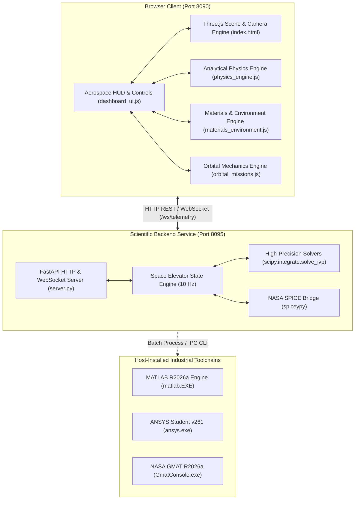

# CURRENT ARCHITECTURE MAP
## SPACE ELEVATOR COMPUTATIONAL DIGITAL TWIN
**Document Identifier:** ARCH-SE-2026-MAP-001  
**Version:** 3.0.0  
**Target Architecture:** Hybrid WebGL / FastAPI Multiphysics Simulation Stack  

---

### 1. HIGH-LEVEL SYSTEM TOPOLOGY

---

### 2. DETAILED SUBSYSTEM BREAKDOWN

#### Subsystem A: WebGL Simulator & Scene Hierarchy (`index.html`)
- **Document Root:** `C:\Users\user\Desktop\Space_Elevator_CAD_Phase1\WebGL_Simulator`
- **Protected CAD Assets:**
  1. `models/international_space_elevator.glb` (Ground anchor megatall skyscraper)
  2. `models/dm_space_day_1_-_space_elevator_(1).glb` (Climber vehicle assembly)
  3. `models/day1_space_elevator.glb` (Apex station counterweight assembly)
- **Kinematic Node Structure:**
  - `scene`
    - `heliocentricGroup` (Mode 2: Solar System Frame)
      - `sunMesh` (Radius: 25.0 units, Emissive Shader)
      - `earthOrbitPath` (Keplerian Ellipse $a = 150.0$, $e = 0.0167$)
      - `earthPivotGroup` (Revolving at orbital velocity $n = 2\pi / 365.256\text{ d}$)
        - `earthAxialGroup` (Obliquity tilt: $\epsilon = 23.44^\circ$)
          - `earthMesh` (Rotating at sidereal rate: $\Omega = 7.2921159 \times 10^{-5}\text{ rad/s}$)
          - `groundAnchor` (Attached at equatorial coordinate $0.00^\circ\text{ N}, 77.59^\circ\text{ E}$)
          - `tetherLineMesh` (100,000 km line geometry, 1,000 vertices)
          - `climberGroup` (Traversing along tether axis from 0 to 100,000 km)
          - `apexStationGroup` (Stationed at 100,000 km altitude counterweight)

#### Subsystem B: Client-Side Computational Engines
1. `physics_engine.js` (1,236 lines):
   - WGS-84 Gravitational Potential and Centrifugal acceleration routines.
   - Pearson exponential taper continuum formulation: $A(r) = A_0 \exp[\dots]$.
   - Coriolis lateral dynamic deflections: $a_{cor} = -2(\vec{\Omega} \times \vec{v})$.
   - Multi-layer atmospheric aerodynamic drag up to $1,000\text{ km}$ altitude.
2. `materials_environment.js` (950 lines):
   - Multi-material degradation engine (SWCNT, Graphene, Super-Laminate, BNNT).
   - Atomic oxygen (AO) erosion in Low Earth Orbit ($200 - 800\text{ km}$).
   - Van Allen radiation dose rates (Inner Proton Belt, Outer Electron Belt).
   - Solar radiation pressure and Earth penumbra/umbra thermal eclipse cycles.
3. `orbital_missions.js` (1,150 lines):
   - Hyperbolic excess energy $C_3$ calculations for release at any altitude.
   - Interplanetary Hohmann and bi-elliptic transfer trajectory parameters (Mars, Venus, Jupiter).
   - Delta-V savings comparison versus terrestrial chemical/nuclear rocket stages.
4. `dashboard_ui.js` (3,003 lines):
   - Comprehensive telemetry HUD, real-time Chart.js/Canvas graph updates, modal panels, view mode switching, and live system diagnostics.

#### Subsystem C: Scientific Backend (`backend/server.py`)
- **Port:** 8095
- **Framework:** FastAPI with Uvicorn ASGI server.
- **REST Endpoints:**
  - `GET /api/health`: System health and detected external tool status.
  - `GET /api/capabilities`: Detailed list of scientific modules and solver capabilities.
  - `GET /api/simulation/state`: Full 10 Hz physical state vector.
  - `POST /api/simulation/configure`: Update physical simulation parameters in real time.
  - `POST /api/analysis/orbital`: High-precision trajectory calculation via SciPy.
  - `POST /api/analysis/structural`: Detailed 1,000-node FEA tension and stress profile.
- **WebSocket Route:**
  - `WS /ws/telemetry`: Streaming real-time JSON packets at 10 Hz.
