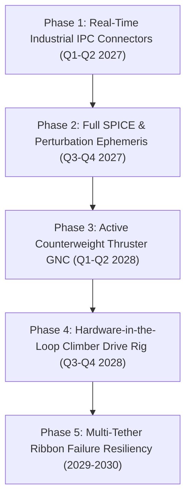

# ENGINEERING IMPROVEMENT ROADMAP
## SPACE ELEVATOR COMPUTATIONAL DIGITAL TWIN
**Document Identifier:** ROAD-SE-2026-ENG-001  
**Planning Horizon:** 2026 – 2030 Multidisciplinary Technology Maturation  

---

### 1. PHASED INDUSTRIAL INTEGRATION TIMELINE

---

### 2. DETAILED PHASE SPECIFICATIONS

#### Phase 1: Real-Time Industrial IPC Connectors
- **Goal:** Replace file-based batch triggers with real-time zero-copy IPC bridges.
- **Milestones:**
  1. Integrate `matlab.engine` Python package to directly execute dynamic multi-body matrices in memory.
  2. Implement `PyAnsys` (PyMAPDL) gRPC service connecting the FastAPI backend directly to ANSYS solver memory.
  3. Automate live GMAT mission runs for multi-body Moon/Sun tidal perturbation vectors.

#### Phase 2: Full SPICE Ephemeris & Perturbation Suite
- **Goal:** Couple local tether dynamics to real-time solar system gravitational fields.
- **Milestones:**
  1. Ingest JPL DE440 ephemeris kernels (`de440.bsp`) via `spiceypy`.
  2. Compute real-time third-body lunar and solar gravitational gradients acting non-uniformly along the 100,000 km tether length.
  3. Model dynamic equatorial ground anchor oceanic platform positioning under tidal swells.

#### Phase 3: Active Counterweight Thruster GNC
- **Goal:** Active stabilization of transverse pendulum modes and resonant oscillations.
- **Milestones:**
  1. Design continuous low-thrust ion/plasma propulsion arrays stationed at the 100,000 km apex counterweight.
  2. Implement Kalman-filter state estimation on climber-induced Coriolis sway.
  3. Validate closed-loop damping algorithms capable of eliminating transverse displacements within $< 4.0\text{ hours}$.

#### Phase 4: Hardware-in-the-Loop (HIL) Climber Drive Rig
- **Goal:** Synchronize simulator telemetry with physical pinch-roller motor testbenches.
- **Milestones:**
  1. Standardize telemetry streams over UDP/EtherCAT for sub-millisecond hardware motor controllers.
  2. Emulate high-temperature ceramic traction roller slip and wear under vacuum conditions.

#### Phase 5: Multi-Ribbon Redundancy & Hypervelocity Debris Slicing Resiliency
- **Goal:** Architectural transition from a single monolithic ribbon to curved, cross-linked multi-tether ribbons.
- **Milestones:**
  1. Model $20\text{ mm}$ space debris severed strand load redistribution across adjacent redundant ribbons.
  2. Implement automated repair climber swarms with localized CNT micro-stitching end-effectors.
